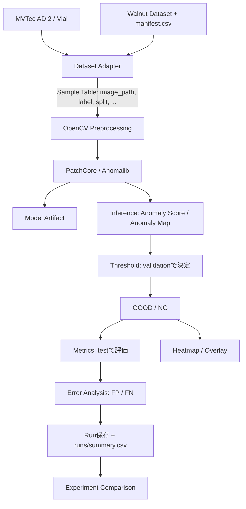

# Industrial Visual Anomaly Detection PoC

製品画像から正常 / 異常（GOOD / NG）を判定し、異常箇所をHeatmapで可視化し、評価・誤判定分析・条件変更後の再評価までを行う外観異常検知のPoCです。

- **Phase 1**: 公開産業データセット MVTec AD 2 / Vial でPipeline全体を検証
- **Phase 2**: スマートフォンで撮影した独自くるみDataset（割れ `crack` / 欠け `chip`）を同じPipelineで検証

## Overview

異常検知ModelにはAnomalibのPatchCoreを使います。PatchCoreは正常画像の特徴量からMemory Bankを作り、それとの距離を異常スコアにします。学習には正常画像だけを使います。

データ準備から再評価まで、次の処理をPythonモジュールとして実装し、Jupyter Notebookから操作します。

データ準備 → OpenCV前処理 → PatchCore学習 → 推論 → Threshold判定 → 異常箇所可視化 → 評価 → 誤判定分析 → 条件変更 → 再評価 → Run比較

評価データの扱いは次のとおりです。

- 学習（train）、Thresholdの決定（validation）、最終評価（test）には、それぞれ別の画像を使います。
- READMEやSummaryに載せる指標は、Thresholdの決定に使っていないtestでの値です。

## Architecture



- Dataset固有の処理はAdapter（`datasets/mvtec.py`、`datasets/walnut.py`）だけです。どちらも共通のSample Table（列: `image_path`、`label`、`label_index`、`mask_path`、`split`、`defect_type`、`object_id`）を返します。
- 前処理以降のPipeline（`experiments/pipeline.py`）は、Phase 1とPhase 2で共通です。
- 前処理は画像の読み込み時に適用します。元画像は変更しません。

## Features

- **Dataset Adapter**
  - MVTec AD 2: Anomalib公式のDirectory解析を使い、`test_public` をvalidation / testへ層化分割します。
  - Walnut: Manifestを作成・検証します。必須列、ファイルの存在、値、trainへの異常画像の混入、`object_id` の漏れ（split間の重複）を検証します。
- **OpenCV前処理**
  - Resize / Crop / Contrast / CLAHE / Denoise / Normalize を、YAMLでON/OFFできます。処理順序は固定です。
  - 処理前後の比較表示ができます。
- **PatchCore**: Anomalib実装のWrapperです。生成・学習・保存・読み込み・推論を行い、GPUを自動で使い、使えない場合はCPUへFallbackします。
- **Threshold**
  - auto: validationでF1最大のThresholdを、Anomalibの `F1AdaptiveThreshold` で決めます。
  - manual: 設定値を使います。
  - 学習し直さずに、Thresholdだけを変えて再評価できます。
- **評価**
  - Image-level: Recall / Precision / F1 / Accuracy / AUROC / AUPR / Confusion Matrix
  - Pixel-level（Maskがある場合）: Pixel AUROC / AUPRO
- **可視化**: Original / Anomaly Heatmap / Overlay を表示し、Threshold以上の領域をContourとBounding Boxで示します。画像ファイルとして保存できます。
- **誤判定分析**: False Negative（見逃し）とFalse Positive（過検知）を抽出して一覧表示します。見逃しを先に表示できます。
- **Run管理**: 実行条件と結果をRun単位で保存し、`runs/summary.csv` へ追記します。Notebookで複数のRunを比較できます。
- **再現性**: Seedを固定し、Config SnapshotとPython・主要PackageのVersion・Device・Dataset情報を保存します。

## Tech Stack

| 分類 | 技術 |
|---|---|
| 言語 / 環境 | Python 3.12, uv, Jupyter Notebook / JupyterLab |
| 画像処理 | OpenCV |
| Deep Learning | PyTorch（CUDA 13.0ビルド）, Lightning |
| 異常検知 | Anomalib 2.6（PatchCore） |
| 評価 | scikit-learn, Anomalib Metrics |
| データ・可視化 | NumPy, pandas, Matplotlib |
| 設定 | YAML（PyYAML） |
| テスト / Lint | pytest, Ruff |

## Project Structure

```text
industrial-visual-anomaly-detection/
├─ notebooks/
│  ├─ 01_phase1_mvtec_vial.ipynb     Phase 1の実行・分析
│  ├─ 02_phase2_walnut.ipynb         Phase 2の実行・分析（Dataset Validation含む）
│  └─ 03_error_analysis.ipynb        複数Runの比較とFP / FN確認
├─ src/anomaly_detection/
│  ├─ datasets/        base.py（Sample Table）, mvtec.py, walnut.py, datamodule.py（Anomalib接続）
│  ├─ preprocessing/   pipeline.py（OpenCV前処理）
│  ├─ models/          patchcore.py（PatchCore Wrapper）
│  ├─ training/        trainer.py
│  ├─ inference/       predictor.py
│  ├─ evaluation/      threshold.py, metrics.py, error_analysis.py
│  ├─ visualization/   anomaly_visualizer.py, run_comparison.py
│  ├─ experiments/     pipeline.py（共通Pipeline）, run_manager.py（Run保存・Summary）
│  └─ utils/           config.py, device.py, logging.py, reproducibility.py
├─ configs/            phase1_mvtec_vial.yaml, phase2_walnut.yaml
├─ tests/              pytest（合成データのみを使用）
├─ data/               Dataset配置先（Git管理外。data/README.md参照）
├─ runs/               実行結果（Git管理外）
├─ assets/             README用のサンプル画像
├─ pyproject.toml / uv.lock
└─ README.md
```

## Setup

必要なもの:

- [uv](https://docs.astral.sh/uv/)
- NVIDIA GPUを使う場合は、CUDA 13.0に対応したドライバー

GPUがなくてもCPUで実行できます。ただし、学習時間は長くなります。

```bash
# uvのインストール（未導入の場合）
# Windows (PowerShell): powershell -ExecutionPolicy ByPass -c "irm https://astral.sh/uv/install.ps1 | iex"
# macOS / Linux:        curl -LsSf https://astral.sh/uv/install.sh | sh

git clone <this repository>
cd industrial-visual-anomaly-detection
uv sync            # Python 3.12と依存Package（uv.lockで固定）をインストール
uv run pytest      # 動作確認（実データ・GPU不要）
```

- WindowsとLinuxでは、PyTorch / torchvisionをCUDA 13.0ビルド（`cu130`）の配布元から取得します。
  - RTX 50系（Blackwell）で動作させるためにこの組み合わせを選びました。cu126ビルドは非対応で、cu128ビルドはPyTorch 2.11以降の提供がありません。
- 初回の学習時に、Backbone（Wide ResNet50）の学習済み重みをHugging Face Hubから自動でDownloadします。

## Dataset

Dataset本体はRepositoryに含めていません。配置の詳細は [data/README.md](data/README.md) を参照してください。

### MVTec AD 2（Phase 1）

- 提供元: MVTec Software GmbH
- 取得: 公式ページ <https://www.mvtec.com/company/research/datasets/mvtec-ad-2> のフォームから取得します。使うのは `vial` だけです。
- License: CC BY-NC-SA 4.0（商用利用不可）
- 配置: `data/mvtec_ad2/vial/{train,validation,test_public,...}`

MVTec AD 2の `validation/` は正常画像のみのため、F1でThresholdを決められません。そこで、正解付きの `test_public` を正常 / 異常の比率を保ったまま分割します。

| split | 元データ | 用途 |
|---|---|---|
| train | `train/good` | PatchCoreの学習 |
| validation | `test_public` の半分（`dataset.threshold_split_ratio`、seed固定） | Threshold決定のみ |
| test | `test_public` の残り | 最終評価 |

`validation/good` と、正解が公開されていない `test_private*` は使いません。

### Walnut Dataset（Phase 2）

```text
data/walnut/
├─ raw/
│  ├─ good/    正常
│  ├─ crack/   割れ
│  └─ chip/    欠け
└─ manifest.csv   列: image_path,label,defect_type,split,object_id
```

- ファイル名は `<object_id>_<連番>.jpg` とします（例: `G001_1.jpg`）。
- 同じ個体を複数角度で撮った画像は同じ `object_id` にします。これにより、同じ個体の画像がtrainとtestに跨がりません。
- `manifest.csv` は、Notebook 02の「Manifest作成」セルか `WalnutAdapter.build_manifest()` で作成できます。
  - split比率は `configs/phase2_walnut.yaml` の `dataset.split` で変更できます。
  - 異常画像はvalidation / testだけに割り当てます。
- Ground Truth Maskは作成しないため、Image-level評価のみを行います。

## Run Phase 1

```bash
uv run jupyter lab
```

`notebooks/01_phase1_mvtec_vial.ipynb` を上から順に実行します。

| Section | 内容 |
|---|---|
| 1. Environment / 2. Config | Version・Deviceの表示、設定の読み込み |
| 3. Dataset Overview / 4. Preprocessing | 件数・サンプル画像、前処理前後の比較 |
| 5. Training | `run_experiment` を実行（学習〜評価〜保存） |
| 6. Inference / 7. Metrics / 8. Visualization | 推論結果、評価指標、Heatmap / Overlay |
| 9. Error Analysis | FP / FN の一覧と、Thresholdを変えた再評価 |
| 10. Experiment Result | Run保存先とSummary |

Datasetが未配置の場合は、配置方法を表示して以降のセルをスキップします。

## Run Phase 2

`notebooks/02_phase2_walnut.ipynb` を実行します。構成はPhase 1と同じで、次の2つを追加しています。

- Manifest作成（`BUILD_MANIFEST = True` のときだけ実行）
- Dataset Validation（good / crack / chip の件数、splitごとの件数、`object_id` のsplit跨ぎ）

Datasetが未配置の場合は、Directory構成とManifestの作成方法を表示して以降をスキップします。

## Training / Inference / Evaluation

Notebookを使わずにPythonから実行することもできます。

```python
from anomaly_detection.experiments.pipeline import reevaluate, run_experiment

# 学習 → Model保存 → 推論 → Threshold決定（validation） → 評価（test） → 可視化 → Run保存
result = run_experiment("configs/phase1_mvtec_vial.yaml")
print(result.metrics["image"])

# 学習し直さず、保存済みスコアに手動Thresholdを適用して再評価（新しいRunとして保存）
reevaluated = reevaluate(result.run.run_dir, threshold=35.0)
```

個別の処理も呼び出せます。

- 学習: `training.trainer.train_patchcore`
- Modelの読み込み: `models.patchcore.load_patchcore`
- 推論: `inference.predictor.predict`
- Threshold: `evaluation.threshold`
- 指標: `evaluation.metrics`

主要な条件は `configs/*.yaml` で変更します。

| 変更したい条件 | 設定項目 |
|---|---|
| 前処理 | `preprocessing.*` |
| Threshold決定用データの割合 | `dataset.threshold_split_ratio` |
| Walnutのsplit比率 | `dataset.split` |
| 学習条件 | `model.backbone`, `model.layers`, `model.coreset_sampling_ratio`, `model.num_neighbors` |
| Threshold | `threshold.mode`, `threshold.manual_value`（PatchCoreの生スコア単位） |
| Seed | `project.seed` |
| Device | `runtime.device` |

Runは `runs/<YYYYmmdd_HHMMSS>_<phase>/` に保存します。

| ファイル | 内容 |
|---|---|
| `config.yaml` | 設定のSnapshot |
| `metadata.json` | Seed、Version、Device、Dataset、学習情報、Threshold |
| `metrics.json` | 評価指標 |
| `samples.csv` | split割り当て |
| `predictions.csv` | 画像ごとのスコア・Threshold・判定 |
| `anomaly_maps.npz` | Anomaly Map |
| `run.log` | 実行Log |
| `model/model.ckpt` | 学習済みModel |
| `images/heatmaps/`, `images/overlays/` | 可視化画像 |

## Evaluation Metrics

異常（defect / NG）を陽性クラスとします。

| 指標 | 意味 |
|---|---|
| Recall | 異常品のうちNGと判定できた割合。見逃し（False Negative）を重要なエラーとして扱うため、主要指標とする |
| Precision | NGと判定したもののうち、実際に異常だった割合。低いほど過検知（False Positive）が多い |
| F1 | RecallとPrecisionの調和平均 |
| Accuracy | 全体の正解率。正常 / 異常の件数比に影響される |
| AUROC | Thresholdに依存しない、スコアの分離性能（ROC曲線下面積） |
| AUPR | Thresholdに依存しない、Precision-Recall曲線の要約（scikit-learnのAverage Precision） |
| Pixel AUROC / AUPRO | 異常箇所のLocalization性能（Maskがある場合のみ）。AUPROはFPRの上限0.3で算出（Anomalibの既定） |

これらはこのPoC内で条件を比較するための指標です。MVTec AD 2の公式ベンチマークとは、評価データ（`test_public` の半分）や指標の条件が異なるため、公式の値と直接比較はできません。

## Experiment Comparison

1. `03_error_analysis.ipynb` でFP / FNを確認し、原因の仮説を立てます。
2. Configの条件（前処理、Dataset、学習条件、Threshold）を変えて、Notebook 01 / 02を再実行します。Thresholdだけを変える場合は `reevaluate` を使います。
3. `03_error_analysis.ipynb` で、`runs/summary.csv` の各Runを比較します（指標の表、Recall / Precision / F1 / Thresholdのグラフ、選択したRunのFP / FN）。

ThresholdはPatchCoreの生スコア単位のため、学習条件が異なるRun間では値の大小を直接比較できません。

## Results

以下はすべて実測値です。

### Phase 1: MVTec AD 2 / Vial

実行条件は `configs/phase1_mvtec_vial.yaml` の既定値です。

| 項目 | 値 |
|---|---|
| Model | PatchCore（wide_resnet50_2, layer2+layer3, coreset 0.1, k=9） |
| 入力 | 256×256にResize（前処理はResizeのみ） |
| Seed | 42 |
| 学習 | train/good 291枚。RTX 5070 Tiで約53秒、Memory Bank 29,798件 |
| Threshold | auto。validation 70枚（good 18 / defect 52）でF1最大 → 38.79（生スコア） |
| 評価 | test 70枚（good 17 / defect 53）。Threshold決定には未使用 |

| Recall | Precision | F1 | Accuracy | AUROC | AUPR | FN | FP | Pixel AUROC | AUPRO (FPR≤0.3) |
|---|---|---|---|---|---|---|---|---|---|
| 1.000 | 0.898 | 0.946 | 0.914 | 0.883 | 0.958 | 0 | 6 | 0.669 | 0.843 |

- 同じ条件で4回実行し、すべての指標が一致しました（環境: torch 2.14.0+cu130、anomalib 2.6.2、CUDA）。
- testは異常画像の方が多いため（53対17）、PrecisionとAccuracyはこの件数比の影響を受けます。
- 過検知6件は、照明条件（regular 2 / underexposed 2 / overexposed 1 / shift_2 1）に分散していました。
- 評価データが70枚と少ないため、指標のばらつきは大きいと考えられます。

### Phase 2: Walnut

未実施です（撮影後に追記します）。

## Sample Heatmap

撮影したくるみ画像による結果を、撮影後に `assets/` へ追加する予定です。MVTec AD 2の画像と、その派生物（Heatmap等）はLicense上の配慮からRepositoryに含めていません。

## Tests

```bash
uv run pytest            # 合成データのみ使用（実データ・GPU・ネットワーク不要）
uv run ruff check .
uv run ruff format --check .
```

Config、前処理、Dataset Adapter / Manifest検証、Threshold、指標、可視化、Run管理を確認します。さらに、小さなPatchCore（resnet18、事前学習なし、CPU）で学習〜推論〜再評価のSmoke Testを行います。

## License / Dataset Notice

- **Source Code**: 本Repositoryのソースコードには、利用許諾ライセンスを付与していません。
- **MVTec AD 2 Dataset**
  - MVTec Software GmbHが [CC BY-NC-SA 4.0](https://creativecommons.org/licenses/by-nc-sa/4.0/) で提供しています（商用利用不可）。
  - Dataset本体と、その画像から生成した成果物（学習済みModel、Heatmap等）は、本Repositoryに含めていません。
  - Datasetの利用条件は、本Repositoryのソースコードの扱いとは別に、MVTecのLicenseに従ってください。
- **Walnut Dataset**: 独自に撮影した画像です。大量の画像はRepositoryに登録せず、必要に応じてサンプル画像のみを `assets/` に置きます。
